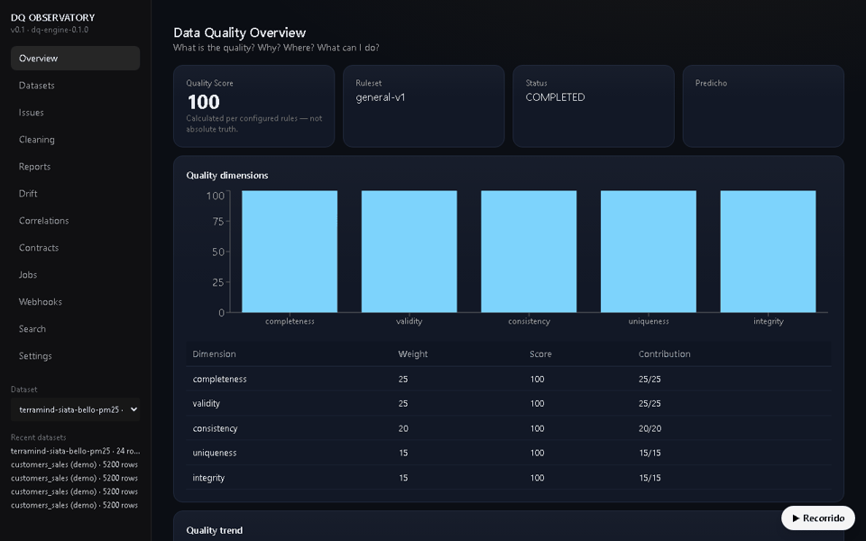
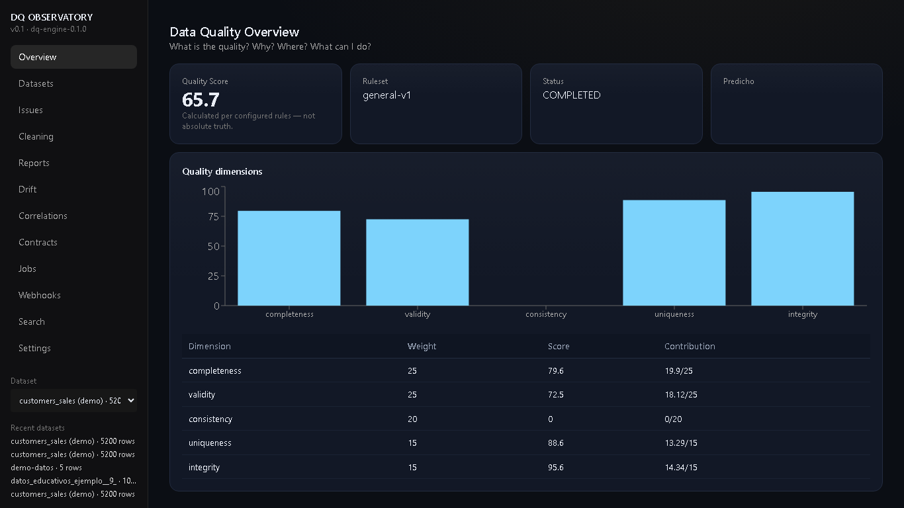
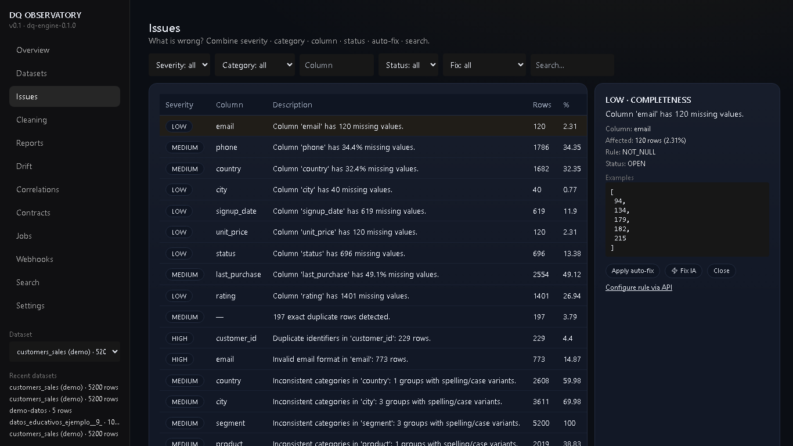
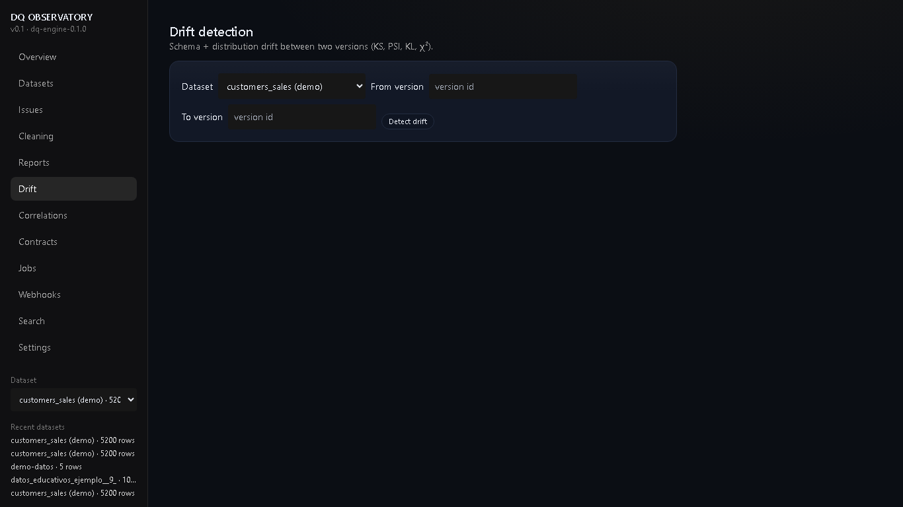
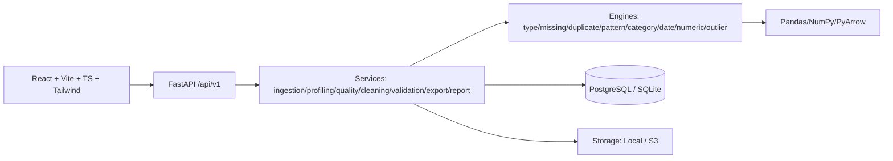

<div align="center">

# 📊 DQ Observatory

**Understand the quality of your data before it reaches production.**

Profile, validate, clean and monitor tabular datasets with a transparent data quality engine.

[](backend/tests)
[](frontend/dist)
[](frontend/e2e)
[](LICENSE)
[](docs/architecture.md)
[](backend/requirements.txt)
[](frontend/package.json)
[](https://render.com)

<br>

<a href="https://dq-observatory.onrender.com">
  
</a>
<a href="https://dq-observatory.onrender.com">
  
</a>
<a href="https://dq-backend-vz1v.onrender.com/docs">
  
</a>

<br>

`Analyze a dataset` · `Try demo dataset` — [`data/demo/customers_sales.csv`](data/demo/customers_sales.csv) (5,200 rows, score ~66/100, 24 issues)



🎬 [Video del recorrido (28s)](docs/demo-tour.webm)

</div>

---

## 🎯 El proyecto en una frase

**Puerta de calidad automática para tus datos** — Subes un CSV/XLSX/JSON y obtienes perfilado determinista, puntaje de calidad transparente y workspace de limpieza con undo — **antes de que el dato roto llegue a producción**.

| Problema | Solución | Resultado |
|----------|----------|-----------|
| Duplicados, vacíos y drift llegan a producción y rompen reportes | Perfilado automático + score transparente + limpieza con preview/undo | El error se detecta antes de costar dinero |

---

## 📸 Capturas de la app en vivo

| Vista | Captura |
|-------|---------|
| **Overview — Score 65.7 + dimensiones** |  |
| **Issues explorer con auto-fix** |  |
| **Drift detection (KS/PSI form)** |  |

> 📸 Capturadas con Playwright (1366×768) del demo vivo: [dq-observatory.onrender.com](https://dq-observatory.onrender.com)
> ⚠️ **Nota honesta**: el backend en producción tiene CORS roto y drift sin gráficas reales — ver commit message para detalles.

---

## 🎥 Demo en video

[Video del recorrido (28s)](docs/demo-tour.webm)

---

## ✨ Features — Qué obtienes

| Área | Qué hace |
|------|----------|
| 📤 **Ingest** | Upload CSV / XLSX / XLS / JSON (validación extensión + MIME + size + encoding, hash, versionado) |
| 🔍 **Profiling determinista** | Tipos físico/semántico + confianza, matriz de nulos, duplicados exactos + por subconjunto, detectores email/tel/URL/UUID/moneda/%, outliers IQR/Z, PII hints, fechas DD/MM ambiguas, numéricos-como-texto |
| ⚡ **Escala** | Profiling paralelo para >10k filas (chunked + sampling sistemático/aleatorio/estratificado) |
| 💯 **Quality Score transparente** | Fórmula: completitud 25 + validez 25 + consistencia 20 + unicidad 15 + integridad 15, con contribuciones por dimensión |
| 🐛 **Issues explorer** | Severidad / categoría / columna / estado / auto-fix / búsqueda + paginación, drawer de detalle, fix en un clic |
| 🧹 **Cleaning workspace** | Preview before/after → apply → nueva versión, undo via lineage, reset a v1, audit log |
| ✅ **Validación DSL** | Reglas estructuradas (`between` / `gte` / `in` / `regex` / `valid_email` …) — **sin `eval`/`exec`** |
| 📊 **Observabilidad** | Tabla salud por columna + página detalle, búsqueda global, tendencia de calidad entre versiones |
| 📉 **Drift detection** | Schema drift + distribution drift entre versiones (KS test, PSI, KL divergence, χ², severidad por columna) |
| 🔗 **Correlaciones** | Pearson / Spearman / Kendall, Cramér's V, Theil's U, correlation ratio, grupos de alta correlación |
| ⏰ **Jobs & Webhooks** | Jobs programados con handler `quality_run` (cron, trigger manual, historial, pause/resume) + webhooks firmados HMAC (`quality_run_completed`, `job_failed`, `drift_detected`…) con retry exponencial |
| 📜 **Governance** | Contratos de datos + breaking-change checks (schema required / type-change, SLA `min_score`) con historial · AutoML validation rules (`POST /{id}/auto-rules`) · Lineage DAG · Stream calidad tiempo real (`WS /api/v1/stream/quality/{id}`) |
| 🔐 **RBAC** | Roles owner / admin / editor / viewer via `X-Role` header (JWT-ready), permisos en jobs/webhooks |
| 📦 **Exports** | CSV / XLSX (sanitizado anti-inyección-fórmula) / JSON / Parquet (Snappy) / Delta Lake (zipped) / Avro / ZIP bundle (limpio + reporte + issues + transformaciones + schema + README) — con selección de columnas, filtros y rangos de fecha |
| 🧭 **Guided tour** | Botón **▶ Recorrido**: 6 pasos (nav → dataset → drift → correlations → jobs → webhooks), barra de progreso, step dots, `Esc` sale, resume desde último paso |

---

## 📊 Caso de estudio real (reproducible)

**Dataset**: demo seed (`data/demo/customers_sales.csv`, 5,200 filas con errores típicos del mundo real). Análisis ejecutado contra la API — todos los números son respuestas reales, reproducibles con `POST /api/v1/datasets/demo/seed`.

| Paso | Resultado |
|------|-----------|
| Perfil inicial | **Score 65.7/100** — completeness 79.6 · validity 72.5 · **consistency 0** · uniqueness 88.6 · integrity 95.6 |
| Issues (24) | 2 HIGH (`customer_id` integridad, `email` validez) · 10 MEDIUM · 12 LOW — top categorías: completeness (9), consistency (5), anomaly (3) |
| `normalize_email` (preview → apply) | Preview: 78 filas afectadas. **Score sin cambios** — normalizar formato ≠ corregir validez: hallazgo honesto |
| `remove_exact_duplicates` (apply) | **5,200 → 5,003 filas (197 duplicados fuera) · score 65.7 → 67.9 (+2.2)** |
| Re-ejecuciones | 0 filas, score estable — operaciones idempotentes, cada paso crea versión (linaje v1→v5, undo disponible) |

**Lectura de analista**: el dataset pierde más por **consistencia (0/20)** — ciudades y categorías con 5+ variantes (`Bogota`/`bogota`/`BOGOTA`…) — que por nulos. El siguiente paso rentable sería `standardize_categories`, no más dedup. Eso es lo que el score transparente permite decidir.

→ Continuación en el **notebook predictivo** [`notebooks/customer_segmentation.ipynb`](notebooks/customer_segmentation.ipynb): del dato sucio al modelo (EDA + baseline RandomForest, todo ejecutable).

**Contrapunto con datos reales**: el Titanic (`datasciencedojo/datasets`, 891 filas) audita **96.0/100** — completeness 83.8 (Cabin HIGH, Age/Embarked LOW) y 100 en el resto, con 8 issues. Dato real ≠ dato perfecto, pero el caos del demo (consistency 0) no aparece. Reproducible: `curl` el CSV → `POST /api/v1/datasets` → `POST .../quality/run`.

---

## ⚡ Quickstart — 3 opciones

### Opción A — Un comando (Windows, recomendado)

```powershell
powershell -ExecutionPolicy Bypass -File scripts/start-demo.ps1
```
Inicia backend `:8000` + frontend `:5173`, siembra dataset demo e imprime URLs. Sin Docker (SQLite por defecto).

### Opción B — Manual (cualquier OS)

```bash
# Backend
python -m venv .venv && source .venv/bin/activate  # windows: .venv\Scripts\activate
python -m pip install -r backend/requirements.txt
cp .env.example backend/.env                      # linux/mac: cp .env.example backend/.env
python scripts/generate_demo_data.py
cd backend && python -m uvicorn app.main:app --reload --port 8000

# Frontend (nueva terminal)
cd frontend && npm install && npm run dev           # http://localhost:5173
```

Variables (`backend/.env`): `DATABASE_URL` · `STORAGE_PATH` · `MAX_UPLOAD_SIZE_MB` · `CORS_ORIGINS` · `LOG_LEVEL`. Ver [`.env.example`](.env.example).

### Opción C — Docker Compose

```bash
docker compose up --build   # frontend :5173 · backend :8000 · postgres :5432
```

### Opción D — URL pública temporal (share your demo)

```bash
cloudflared tunnel --url http://localhost:5173
# → https://<random>.trycloudflare.com  (efímero, gratis, sin cuenta)
```

Para URL permanente, deploy a Render (ver [Deployment](#-deployment)).

---

## 🛠️ Tech Stack

| Capa | Tecnologías |
|------|-------------|
| **Frontend** | React 18, TypeScript, Vite, Tailwind CSS |
| **Backend** | Python 3.11, FastAPI, Pydantic v2 |
| **Datos** | Pandas, NumPy, PyArrow, PostgreSQL / SQLite |
| **Calidad** | Vitest + Testing Library, pytest, Playwright E2E |
| **Deploy** | Render (Blueprint `render.yaml`), Docker Compose |

---

## 🏗️ Arquitectura



Deep dive: [`docs/architecture.md`](docs/architecture.md)

---

## 🚀 Deployment

| Target | How |
|--------|-----|
| **Local** | `scripts/start-demo.ps1` (Windows) o Quickstart manual — uvicorn + vite, SQLite |
| **Docker Compose** | `docker compose up --build` (backend/frontend/postgres) |
| **Render** | Blueprint [`render.yaml`](render.yaml): backend Python + frontend Static + Postgres free. Set `DATABASE_URL`, `CORS_ORIGINS`. **En vivo**: [frontend](https://dq-observatory.onrender.com) · [backend](https://dq-backend-vz1v.onrender.com/docs) |

Detalles: [`docs/deployment.md`](docs/deployment.md)

---

## 🧪 Testing & Benchmarks

```bash
# Backend — 27 tests (engines, API E2E, demo ranges, exports, RBAC, scheduler, webhooks, governance…)
cd backend && python -m pytest -q

# Benchmarks medidos
$env:PYTHONPATH='backend'; python scripts/benchmark.py
# 1k rows → 2.34s / 0.87MB / score 67.6 / 22 issues
# 5.2k rows → 7.5s / 4.51MB / score 65.7 / 24 issues

# Frontend build
cd frontend && npm run build   # PASS ~13s, 891 modules, lazy chunks

# E2E (Playwright) — 7 tests: journey, tour, nav smoke, RBAC, pause/resume, contracts CRUD, drift validation
cd frontend && npx playwright test
```

---

## 🔒 Security

File validation (ext + MIME + size + encoding) · safe filenames · path-traversal guard · parameterized ORM · CSV-formula-injection sanitize (`= + - @` → `'…`) · no `eval`/`exec`/shell · XSS-safe (values never executed) · CORS allowlist · no secrets in logs · temp cleanup. Detalles: [`docs/security.md`](docs/security.md)

---

## 🗺️ Roadmap

- [x] **V1** — upload / profiling / score / issues / cleaning / validation / export / reports
- [ ] **V2** — mapper / contracts / scheduled jobs
- [ ] **V3** — AI assistant (contexto determinístico, no exec)
- [ ] **V4** — pipeline builder
- [ ] **V5** — enterprise observability

Ver [`docs/roadmap.md`](docs/roadmap.md)

---

## ⚠️ Limitaciones

Sync path óptimo para ≤100k filas; sets mayores necesitan chunk/jobs (statuses `QUEUED`/`PROCESSING`/… scaffolded). No verificación real de existencia de email. Canonicalización de teléfonos configurable por país. Fechas ambiguas se marcan, nunca se resuelven silenciosamente.

---

## 🤝 Contribuir

1. Fork → branch (`feat/…` / `fix/…`) → PR con descripción clara
2. Backend: `cd backend && python -m pytest -q` debe seguir en verde (27/27)
3. Frontend: `cd frontend && npm run build` debe pasar; agregar test Playwright para flujos user-facing
4. Seguir DSL/estilo existente — engines determinísticos, no `eval`/`exec`, sanitizar exports

---

## 🎮 Demo en vivo

[https://dq-observatory.onrender.com](https://dq-observatory.onrender.com) · [API docs](https://dq-backend-vz1v.onrender.com/docs) — prueba el dataset demo (5,200 filas, score ~66/100) sin subir nada.

## 🔧 Casos de uso

| Perfil | Qué haces |
|--------|-----------|
| **Data Engineer** | Sube CSV → perfilado determinístico → score transparente → exporta limpio + auditoría |
| **Analista de negocio** | Dashboard de issues por severidad → auto-fix → reportes ejecutivos before/after |
| **ML Engineer** | Detecta drift (KS/PSI/KL) entre versiones → lineage DAG → notebook predictivo adjunto |
| **Equipo / Governance** | Contratos de datos + SLA `min_score` → webhooks HMAC → RBAC roles (owner/admin/editor/viewer) |

---

## 📄 Licencia

MIT — ver [LICENSE](LICENSE).

---

<div align="center">

**[⬆ back to top](#-dq-observatory)**

Built with FastAPI · React · Pandas — *know your data before production does.*

</div>